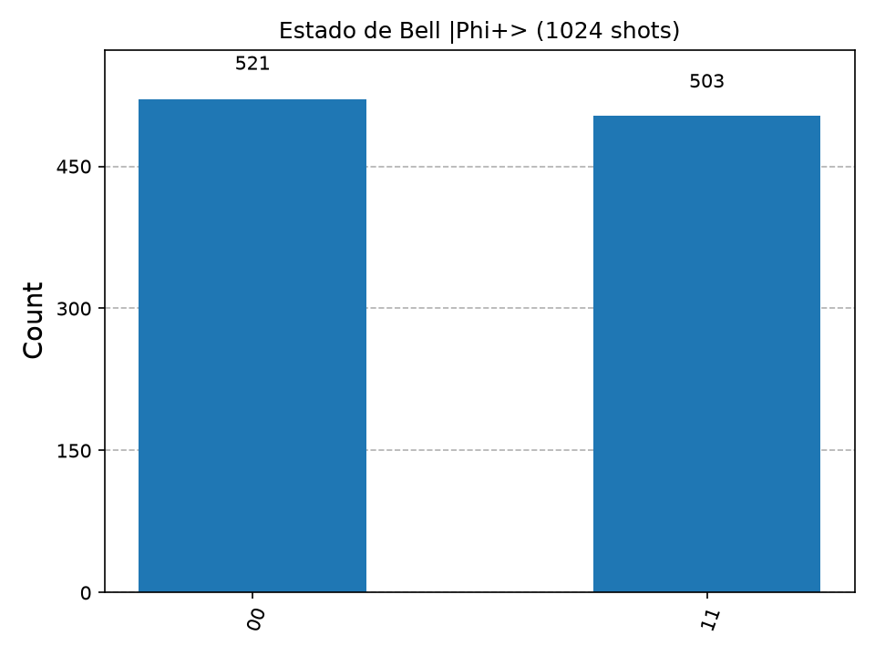
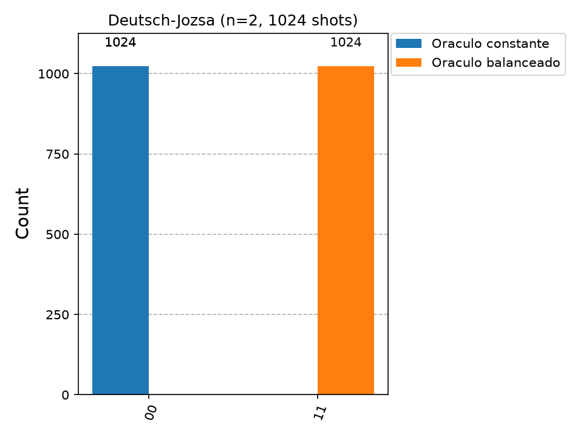
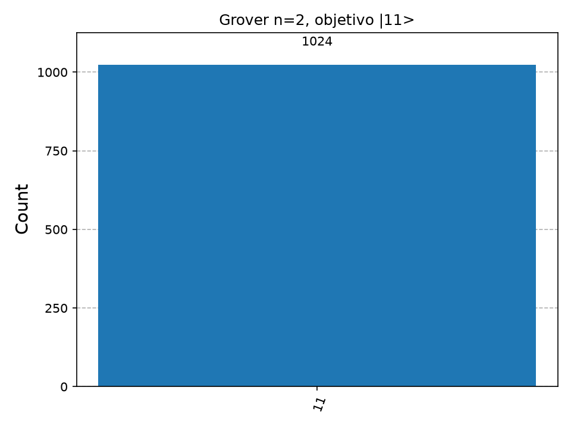
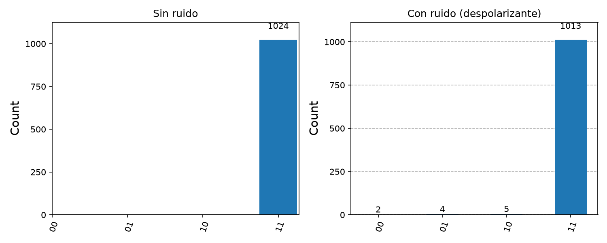
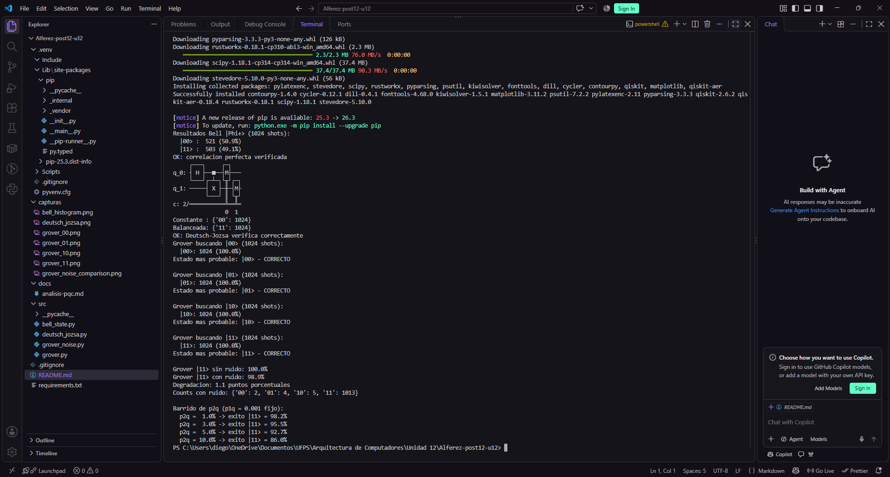

# Alferez-post12-u12 — Computación cuántica: laboratorio Qiskit y análisis PQC

**Arquitectura de Computadores · Unidad 12 · Post-contenido (UFPS)**

Repositorio único con las dos partes de la actividad:

- **Parte 1** — Laboratorio de circuitos cuánticos con Qiskit sobre `AerSimulator` (estado de Bell, Deutsch-Jozsa, Grover de 2 qubits y Grover bajo ruido despolarizante). Código en `src/`, capturas en `capturas/`.
- **Parte 2** — Análisis técnico del impacto cuántico en ciberseguridad: [`docs/analisis-pqc.md`](docs/analisis-pqc.md).

## Estructura

```
Alferez-post12-u12/
├── README.md
├── requirements.txt
├── src/
│   ├── bell_state.py
│   ├── deutsch_jozsa.py
│   ├── grover.py
│   └── grover_noise.py
├── capturas/
│   ├── bell_histogram.png
│   ├── deutsch_jozsa.png
│   ├── grover_00.png  grover_01.png  grover_10.png  grover_11.png
│   └── grover_noise_comparison.png
└── docs/
    └── analisis-pqc.md
```

## Entorno y ejecución

Python 3.9 o superior. Todo corre sobre el simulador clásico `AerSimulator` (no se usa hardware real ni cuenta de IBM Quantum).

```bash
pip install -r requirements.txt
python src/bell_state.py
python src/deutsch_jozsa.py
python src/grover.py
python src/grover_noise.py
```

Cada script se ejecuta desde la raíz del repositorio (o desde `src/`), imprime sus resultados y guarda sus histogramas en `capturas/`. Los experimentos con aleatoriedad usan `seed_simulator=42`, así que los números de este README se reproducen con la misma versión de Qiskit Aer.

> Nota de convención: Qiskit ordena los bits en *little-endian*. En una cadena como `"01"`, el carácter de la derecha es el qubit 0 y el de la izquierda el qubit 1. El oráculo de `grover.py` respeta esa convención (se aplican puertas X sobre los qubits cuyo bit objetivo es `0`), de modo que `target="01"` marca realmente el estado `|01⟩`.

---

## 1. Estado de Bell — `src/bell_state.py`

El estado |Φ⁺⟩ = (|00⟩ + |11⟩)/√2 se prepara con una Hadamard sobre q0 (superposición) y una CNOT con q0 como control (entrelazamiento).

```
     ┌───┐     ┌─┐
q_0: ┤ H ├──■──┤M├───
     └───┘┌─┴─┐└╥┘┌─┐
q_1: ─────┤ X ├─╫─┤M├
          └───┘ ║ └╥┘
c: 2/═══════════╩══╩═
                0  1
```

| Estado | Conteos (1024 shots) | Porcentaje |
|:------:|:--------------------:|:----------:|
| `00`   | 521                  | 50.9 %     |
| `11`   | 503                  | 49.1 %     |
| `01`, `10` | 0                | 0 %        |

**Interpretación:** al medir un qubit el resultado es aleatorio (50/50), pero el segundo qubit siempre coincide con el primero. Nunca aparecen `01` ni `10`: esa correlación perfecta es la huella del entrelazamiento y el `assert` del script lo verifica.



---

## 2. Deutsch-Jozsa — `src/deutsch_jozsa.py`

Determina si `f: {0,1}² → {0,1}` es constante o balanceada con **una sola** evaluación del oráculo. Un qubit ancilla en |−⟩ convierte la acción del oráculo en una fase `(-1)^f(x)` (*phase kickback*), y la segunda capa de Hadamard hace interferir las amplitudes.

Circuito con el oráculo balanceado (f(x) = x₀ ⊕ x₁):

```
     ┌───┐      ░            ░ ┌───┐┌─┐
q_0: ┤ H ├──────░───■────────░─┤ H ├┤M├───
     ├───┤      ░   │        ░ ├───┤└╥┘┌─┐
q_1: ┤ H ├──────░───┼────■───░─┤ H ├─╫─┤M├
     ├───┤┌───┐ ░ ┌─┴─┐┌─┴─┐ ░ └───┘ ║ └╥┘
q_2: ┤ X ├┤ H ├─░─┤ X ├┤ X ├─░───────╫──╫─
     └───┘└───┘ ░ └───┘└───┘ ░       ║  ║
c: 2/════════════════════════════════╩══╩═
                                     0  1
```

| Oráculo | Resultado (1024 shots) | Conclusión |
|---------|------------------------|------------|
| Constante (f = 0) | `{'00': 1024}` | constante |
| Balanceado (f = x₀ ⊕ x₁) | `{'11': 1024}` | balanceada (nunca `00`) |

**Interpretación:** el resultado es determinista. Si la función es constante, todas las amplitudes interfieren constructivamente en `|00⟩`; si es balanceada, esa amplitud se anula y la medición nunca da `00` (aquí da `11`). El algoritmo necesita exactamente **1** evaluación del oráculo, mientras que un algoritmo clásico determinista necesita, en el peor caso, 2ⁿ⁻¹ + 1 = **3** evaluaciones para n = 2.



---

## 3. Grover con 2 qubits — `src/grover.py`

Búsqueda de un elemento marcado entre N = 4. Circuito para `target = "11"` (oráculo = CZ; difusor = H·X·CZ·X·H):

```
     ┌───┐   ┌───┐┌───┐   ┌───┐┌───┐┌─┐
q_0: ┤ H ├─■─┤ H ├┤ X ├─■─┤ X ├┤ H ├┤M├───
     ├───┤ │ ├───┤├───┤ │ ├───┤├───┤└╥┘┌─┐
q_1: ┤ H ├─■─┤ H ├┤ X ├─■─┤ X ├┤ H ├─╫─┤M├
     └───┘   └───┘└───┘   └───┘└───┘ ║ └╥┘
c: 2/════════════════════════════════╩══╩═
                                     0  1
```

| Objetivo | Estado más probable | Probabilidad (1024 shots) | Veredicto |
|:--------:|:-------------------:|:-------------------------:|:---------:|
| `00` | `00` | 100.0 % | correcto |
| `01` | `01` | 100.0 % | correcto |
| `10` | `10` | 100.0 % | correcto |
| `11` | `11` | 100.0 % | correcto |

**Por qué basta 1 iteración:** con N = 4 y un solo elemento marcado, el ángulo inicial cumple sin θ = 1/√N = 1/2, es decir θ = 30°. Tras k iteraciones la amplitud del estado marcado es sin((2k+1)θ); con k = 1 resulta sin 90° = 1, o sea probabilidad 1. El número óptimo de iteraciones, (π/4)·√N ≈ 1.57, se redondea a 1. Una segunda iteración sobrepasaría el máximo y bajaría la probabilidad.

Histogramas: [`grover_00`](capturas/grover_00.png) · [`grover_01`](capturas/grover_01.png) · [`grover_10`](capturas/grover_10.png) · [`grover_11`](capturas/grover_11.png)



---

## 4. Grover bajo ruido despolarizante — `src/grover_noise.py`

Se reutiliza el circuito de Grover (`target="11"`, importado de `grover.py`) y se ejecuta dos veces: sin ruido y con un `NoiseModel` que aplica error despolarizante de 0.1 % a cada puerta de 1 qubit (`h`, `x`) y de 1 % a cada puerta de 2 qubits (`cz`). El circuito contiene 10 puertas de 1 qubit y 2 puertas CZ.

| Simulación | Éxito del estado `11` | Conteos (1024 shots) |
|------------|:----------------:|----------------------|
| Sin ruido | 100.0 % | `{'11': 1024}` |
| Con ruido (p1q = 0.1 %, p2q = 1 %) | 98.9 % | `{'00': 2, '01': 4, '10': 5, '11': 1013}` |
| **Degradación** | **1.1 puntos porcentuales** | — |

Complemento incluido en el script (barrido de la tasa de error de 2 qubits, 4096 shots, p1q = 0.1 % fijo):

| p2q | 1 % | 3 % | 5 % | 10 % |
|-----|:---:|:---:|:---:|:----:|
| Éxito del estado `11` | 98.2 % | 95.5 % | 92.7 % | 86.0 % |

**Interpretación:** los errores pequeños de cada puerta se acumulan y reparten probabilidad hacia los estados incorrectos, que antes tenían probabilidad exactamente 0. Con las tasas pedidas la degradación es medible pero pequeña (≈ 1–2 puntos), porque este circuito tiene solo dos puertas de 2 qubits. Para ver una caída de varios puntos hay que subir la tasa de error (barrido) o aumentar el número de puertas, que es justo lo que ocurre al escalar el algoritmo.



---

## 5. Decisión técnica — ¿el resultado de Grover con ruido sigue siendo útil o requiere corrección de errores?

Con las tasas configuradas (0.1 % en puertas de 1 qubit y 1 % en las de 2 qubits), la probabilidad de éxito de `|11⟩` pasó de 100 % a 98.9 %. De los 1024 disparos, 1013 cayeron en `|11⟩` y ningún estado incorrecto superó 5 conteos, de modo que el estado objetivo es unas doscientas veces más frecuente que cualquiera de los otros tres. Con 1024 shots la desviación estándar de esa proporción es de apenas unas décimas de punto porcentual, así que la respuesta se identifica con total confianza estadística: para este circuito de 2 qubits y profundidad mínima, el resultado es útil sin corrección de errores. El problema aparece al escalar. El error no se suma de forma lineal: la fidelidad aproximada decae como (1 − ε)^G, con G el número de puertas ruidosas. Un Grover de 20 qubits necesita del orden de (π/4)·2^10 ≈ 800 iteraciones, cada una con una puerta multicontrolada que se descompone en decenas de puertas de 2 qubits; con ε ≈ 1 % la probabilidad de éxito sería exponencialmente pequeña e indistinguible del ruido aleatorio. Incluso a 10 qubits el producto puertas × error ya supera 1. Por eso los circuitos NISQ pequeños y poco profundos (como los de este laboratorio, con del orden de 1/ε ≈ 100 puertas de 2 qubits como máximo) pueden ejecutarse directamente sobre qubits físicos. Los algoritmos con utilidad práctica (Shor sobre claves reales, simulación química) requieren qubits lógicos protegidos por códigos de corrección de errores, y el umbral de tolerancia a fallos (del orden de 1 % para el código de superficie, con un sobrecosto práctico enorme) es la condición para que añadir redundancia mejore el resultado en lugar de empeorarlo.

## 6. Decisión técnica — ¿qué tan representativo es el modelo despolarizante frente al hardware NISQ real?

El modelo `depolarizing_error` aplica la misma probabilidad de error, con la misma mezcla de bit-flip, phase-flip y combinaciones, a cualquier puerta del mismo tipo y en cualquier qubit. En un procesador superconductor real cada qubit tiene tiempos de relajación T1 (|1⟩ → |0⟩) y de decoherencia T2 (pérdida de fase) propios y distintos entre sí, y el error depende del tiempo que el qubit pasa ocioso o ejecutando una puerta. Como una puerta de 2 qubits dura varias veces más que una de 1 qubit, acumula más decoherencia, algo que el modelo uniforme no captura. Tampoco incluye el error de lectura al medir, los errores correlacionados (*crosstalk*) ni la variación de calidad entre pares de qubits acoplados. Aun así, para este laboratorio el modelo simplificado es apropiado: el objetivo pedagógico es mostrar de forma controlada y reproducible que el ruido degrada la fidelidad, y `NoiseModel.from_backend()` ataría el experimento a la disponibilidad y a la calibración cambiante de un backend concreto. Si el objetivo fuera predecir el comportamiento de este circuito en un procesador IBM Quantum específico antes de ejecutarlo en hardware, la elección correcta sería `NoiseModel.from_backend()` con los datos de calibración más recientes de ese dispositivo, porque el modelo despolarizante subestima o sobrestima de forma sistemática los mecanismos de error que no representa.

---

## Checkpoints de la Parte 1

| # | Checkpoint | Script | Captura |
|---|------------|--------|---------|
| 1 | Estado de Bell | `src/bell_state.py` | `capturas/bell_histogram.png` |
| 2 | Deutsch-Jozsa | `src/deutsch_jozsa.py` | `capturas/deutsch_jozsa.png` |
| 3 | Grover 2 qubits | `src/grover.py` | `capturas/grover_00.png` … `grover_11.png` |
| 4 | Grover bajo ruido | `src/grover_noise.py` | `capturas/grover_noise_comparison.png` |
| 5 | Decisiones técnicas | — | secciones 5 y 6 de este README |



La Parte 2 está documentada en [`docs/analisis-pqc.md`](docs/analisis-pqc.md).
